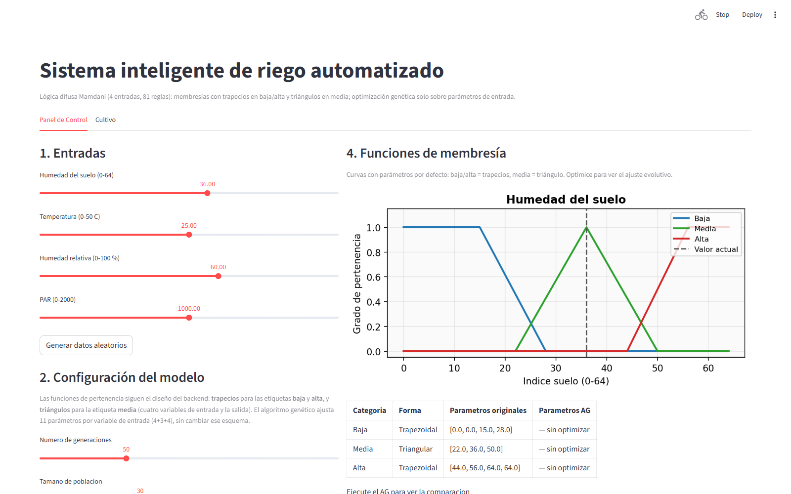
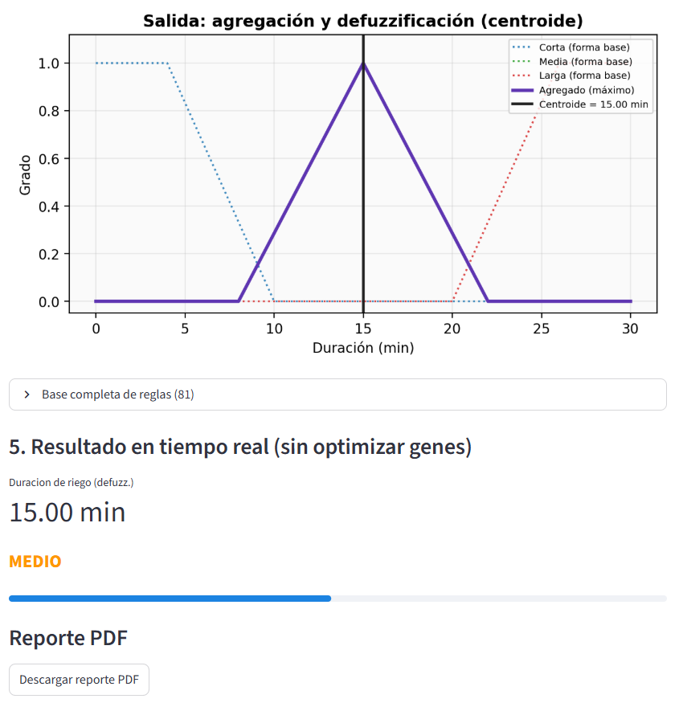
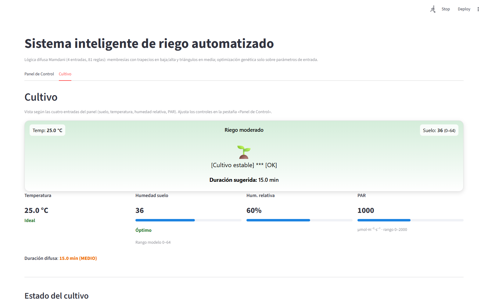

<p align="center">
  
</p>

<p align="center">
  <a href="#funcionalidades">Funcionalidades</a> · <a href="#tecnologías">Tecnologías</a> · <a href="#ejecutar-en-local">Ejecutar en local</a> · <a href="#capturas">Capturas</a>
</p>

Aplicación web para comparar la duración estimada de riego bajo distintas condiciones de cultivo. Usa un controlador difuso Mamdani y permite ajustar sus funciones de pertenencia con un algoritmo genético desde el panel de control.

## Funcionalidades

- **Simulación.** Combina humedad del suelo, temperatura, humedad relativa y radiación fotosintéticamente activa (PAR) para estimar minutos de riego.
- **Comparación.** Presenta el resultado base junto a la propuesta del optimizador genético. Puedes ajustar el tamaño de la población y el número de generaciones.
- **Visualización.** Muestra funciones de pertenencia y una vista del cultivo sincronizada con las entradas del panel.
- **Reporte PDF.** Guarda el resultado de la simulación y sus gráficas desde la interfaz.

## Tecnologías

| Tecnología | Uso |
| --- | --- |
| Python | Reglas difusas, simulación y optimización genética |
| Streamlit | Panel de control y visualización del cultivo |
| NumPy y Matplotlib | Cálculos numéricos y gráficas |
| ReportLab y Pillow | Documento PDF e imágenes del reporte |

El modelo usa pertenencias trapezoidales en los extremos y triangulares en la categoría media. El optimizador propone cambios en las membresías de entrada y compara la estimación resultante con el modelo base.

## Ejecutar en local

Necesitas **Python 3.10 o superior** y `pip`. Ejecuta los comandos desde la raíz del repositorio.

**Windows, PowerShell**

```powershell
python -m venv .venv
.\.venv\Scripts\python.exe -m pip install -r requirements.txt
.\.venv\Scripts\python.exe -m streamlit run main.py
```

**macOS o Linux**

```bash
python3 -m venv .venv
.venv/bin/python -m pip install -r requirements.txt
.venv/bin/python -m streamlit run main.py
```

Abre [localhost:8501](http://localhost:8501). Ajusta las cuatro entradas en **Panel de Control**, revisa la duración estimada y compara con la optimización si quieres evaluar otra configuración. La pestaña **Cultivo** usa los mismos valores.

## Estructura

- [`main.py`](main.py) inicia Streamlit.
- [`ui/`](ui) contiene el panel de control y la vista del cultivo.
- [`logica/fuzzy/`](logica/fuzzy) reúne reglas, inferencia y funciones de pertenencia.
- [`logica/genetico/`](logica/genetico) contiene el algoritmo, su evaluación y los operadores.
- [`logica/`](logica) coordina la simulación y genera el PDF.

## Comprobación del modelo

[`_test_ag.py`](_test_ag.py) compara el resultado base, la propuesta y el resultado final para varios escenarios. Ejecútalo con el mismo intérprete que usaste para instalar las dependencias.

```bash
python _test_ag.py
```

## Capturas

<p align="center">
  <a href="./docs/assets/capturas/riego.png"></a><br><strong>Panel de control y funciones de pertenencia</strong>
</p>

<table width="100%">
  <tr>
    <td width="50%" valign="top" align="center">
      <a href="./docs/assets/capturas/riego-resultado.png"></a><br><sub>Resultado de la simulación</sub>
    </td>
    <td width="50%" valign="top" align="center">
      <a href="./docs/assets/capturas/riego-cultivo.png"></a><br><sub>Visualización del cultivo</sub>
    </td>
  </tr>
</table>
